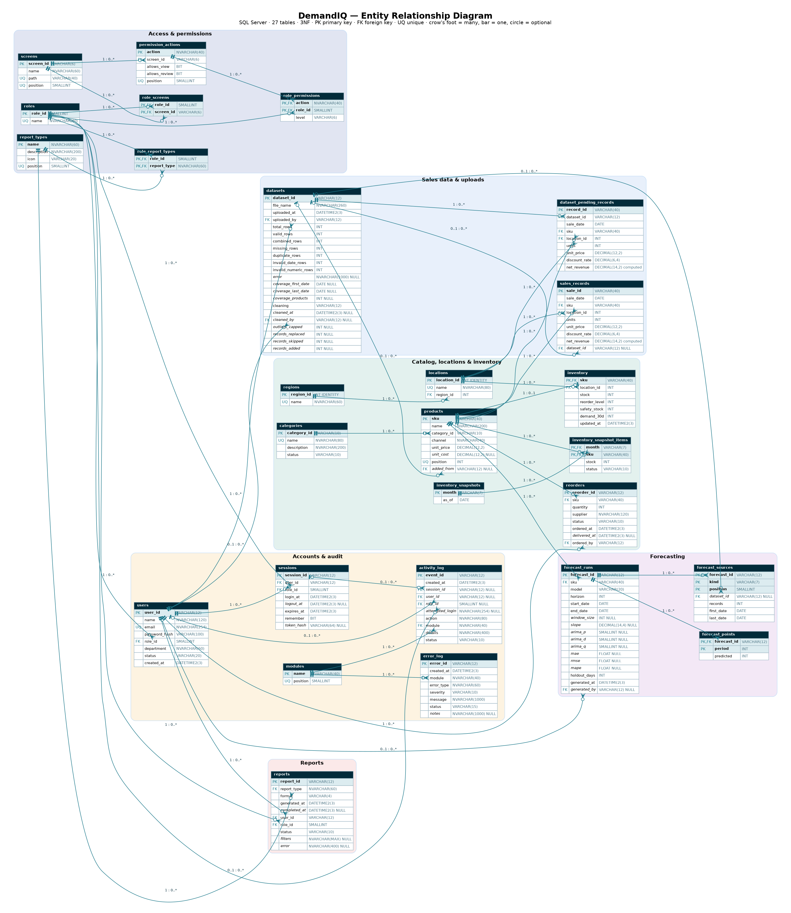

# DemandIQ database (Microsoft SQL Server)

27 tables in third normal form, 9 ID sequences and 4 reporting views. Scripts in `database/`:

| File | Run | What it does |
|---|---|---|
| `00_create_database.sql` | once, as sysadmin | Creates the `DemandIQ` database and the `demandiq_app` login/user (read, write, sequences) |
| `01_schema.sql` | as owner / sysadmin | Drops and recreates every DemandIQ table, sequence and view |
| `02_seed.sql` | after the schema | Replaces all rows with the demo data and restarts the ID sequences |
| `er/DemandIQ_ERD.svg` (`.png`, `.pdf`) | — | The ER diagram; `.dot` (Graphviz) and `.mmd` (Mermaid) are its sources, `generate_er.py` redraws it from the models |
| `seed/demo-data.json` | — | The demo data as exported by the frontend (`npm run export:seed`); the source of `02_seed.sql` |

The SQLAlchemy models in `backend/app/models.py` are the same schema; `backend/tests/test_schema.py` checks that the
DDL, the models and the seed script agree (tables, columns, foreign keys, sequences).

## Entities and relationships

| Area | Table | Primary key | Main relationships (FK → parent, cardinality parent : child) |
|---|---|---|---|
| Access | `roles` | `role_id` (1–4) | — |
| | `screens` | `screen_id` (SCR-01…06) | — |
| | `role_screens` | `role_id, screen_id` | roles 1 : 0..* · screens 1 : 0..* (M:N roles–screens) |
| | `permission_actions` | `action` | screens 1 : 0..* (the screen an action is carried out on) |
| | `role_permissions` | `action, role_id` | permission_actions 1 : 0..* · roles 1 : 0..* (M:N with `level`) |
| | `report_types` | `name` | — |
| | `role_report_types` | `role_id, report_type` | roles 1 : 0..* · report_types 1 : 0..* (M:N) |
| Accounts & audit | `users` | `user_id` (USR-1042) | roles 1 : 0..* |
| | `sessions` | `session_id` (SES-0013) | users 1 : 0..* · roles 1 : 0..* (role signed in with) |
| | `modules` | `name` | — (Authentication, Sales Upload, Data Quality, Forecasting, Inventory, Reports & Exports, Admin Panel) |
| | `activity_log` | `event_id` (EVT-0057) | sessions 0..1 : 0..* · users 0..1 : 0..* · roles 0..1 : 0..* · modules 1 : 0..* |
| | `error_log` | `error_id` (ERR-0011) | modules 1 : 0..* |
| Catalog & inventory | `categories` | `category_id` (CAT-001) | — |
| | `regions` | `region_id` (identity) | — |
| | `locations` | `location_id` (identity) | regions 1 : 0..* |
| | `products` | `sku` | categories 1 : 0..* · datasets 0..1 : 0..* (`added_from`, the upload that added it) |
| | `inventory` | `sku` | products 1 : 0..1 · locations 1 : 0..* |
| | `inventory_snapshots` | `month` (YYYY-MM) | — |
| | `inventory_snapshot_items` | `month, sku` | inventory_snapshots 1 : 0..* · products 1 : 0..* |
| | `reorders` | `reorder_id` (RO-0004) | products 1 : 0..* · users 1 : 0..* (`ordered_by`) |
| Sales | `datasets` | `dataset_id` (DS-0008) | users 1 : 0..* (`uploaded_by`) · users 0..1 : 0..* (`cleaned_by`) |
| | `dataset_pending_records` | `record_id` | datasets 1 : 0..* · products 1 : 0..* · locations 1 : 0..* |
| | `sales_records` | `sale_id` (UQ `sale_date, sku`) | products 1 : 0..* · locations 1 : 0..* · datasets 0..1 : 0..* (lineage) |
| Forecasting | `forecast_runs` | `forecast_id` (FC-0012) | products 1 : 0..* · users 0..1 : 0..* |
| | `forecast_points` | `forecast_id, period` | forecast_runs 1 : 0..* |
| | `forecast_sources` | `forecast_id, kind, position` | forecast_runs 1 : 0..* · datasets 0..1 : 0..* |
| Reports | `reports` | `report_id` (RPT-022) | report_types 1 : 0..* · users 1 : 0..* · roles 1 : 0..* |

## Normalisation (3NF)

Each non-key column depends on the key, the whole key and nothing but the key:

- **No derived values stored.** Inventory `status`, `suggested` and `days` are worked out from stock, reorder level,
  safety stock and 30-day demand (API and `vw_inventory_status`); a user's initials from the name; a category's product
  count from `products`; an upload's validation label, pending count and forecasting status from its rows, the sales
  history and the runs' lineage (`vw_dataset_status`); `excludedAtValidation = total − valid − combined`; a forecast
  point's date is `end_date + period`. `net_revenue = units × unit_price × (1 − discount_rate)` is a persisted computed
  column, so it can't disagree with its inputs.
- **Transitive dependencies removed.** Location → region is stored once in `locations` (the old `products.region` next
  to `products.location` was a transitive dependency). Products refer to categories by ID, so a rename reaches every
  product and sale. The activity log no longer copies the user's name: it comes from `users`; only a refused sign-in for
  an unknown account keeps what was typed (`attempted_login`).
- **Atomic values.** The old `permission_actions.allowed_levels` array (not 1NF, and not available in SQL Server) is two
  flags, `allows_view` and `allows_review`; filters on a report are one JSON document (`ISJSON` checked) because the app
  stores and replays them as a whole.
- **Historical facts kept on purpose** (they are not redundant): `sessions.role_id` (the role signed in with, for the
  `role_changed` check), `activity_log.role_id` and `reports.role_id` (the role at the time), snapshot `status` (thresholds
  can change later), forecast `lineage` rows (what a run used, even if records are replaced later).

## The earlier review suggestions

| Suggestion | Decision | How |
|---|---|---|
| Add region or location to sales records for sales by region | **Done** | `sales_records.location_id` → `locations` → `regions`; the API's `region`/`location` of a sale come from where it sold. Also on `dataset_pending_records`. |
| Keep product details separate from regional inventory and sales | **Done** | `products` holds only what a product is (name, category, channel, prices). Stock, reorder level, safety stock, 30-day demand and the holding location moved to `inventory`; sales carry their own location. |
| Product-to-SKU mapping only if a product can have several SKUs | **Not added** | In DemandIQ a product *is* a SKU (uploads, forecasts, inventory and reports are all per SKU), so a mapping table would be redundant. |
| Keep `dataset_pending_records` only for a separate validation/cleaning workflow | **Kept** | The app has that workflow: an upload waits (Pending) until a Data Analyst cleans it; pending rows may clash with existing sales for the same day and SKU, so they can't live in `sales_records` yet. |
| Track inventory by location if stock is managed across regions/stores | **Done for the current rule** | `inventory.location_id` records where each product is stocked. Today each product is stocked at one location (the screens show one stock figure per SKU), so the key stays `sku`; see "Open questions" for multi-location stock. |
| Retain inventory snapshots for historical stock analysis | **Kept** | `inventory_snapshots` + `inventory_snapshot_items` feed the Monthly inventory trends chart; there is now a snapshot for every month from Jan 2023. |
| ARIMA parameters only for ARIMA; not required for every forecast | **Done** | `arima_p/d/q` are NULL unless `model = 'ARIMA'` (CHECK constraint); likewise `window_size` (Moving Average) and `slope` (Linear Regression). |
| Retain `forecast_points` | **Kept** | One row per forecast day (`period`, `predicted`); the date is derived. |
| Retain `categories` | **Kept** | Category filters, Sales by Category, Stock by category, Product Performance. |
| Rename the error timestamp to `created_at`; module FK only with a modules table | **Done** | `error_log.created_at` (and `activity_log.created_at`); a small `modules` table is referenced by both logs, so module names can't drift (the Admin dashboard groups by them). |

Not created, to keep the model small: no separate suppliers, departments or channels tables (free-text attributes with
no other facts about them today), no product-SKU table, no email-queue table (emails are logged in `activity_log`).

## Demo data: every date filter has data

| Data | Range / count |
|---|---|
| Sales history | **1 Jan 2023 – 18 Jun 2025**, 7,417 records for 11 products (5 smooth, 2 erratic, 2 intermittent, 2 lumpy demand patterns, with yearly seasonality and growth). 1 Jan 2023 – 18 Dec 2024 is the legacy history migrated at go-live (`dataset_id` NULL); 19 Dec 2024 – 18 Jun 2025 came from four cleaned uploads (DS-0002 … DS-0005). |
| Pending upload | DS-0007, 19–25 Jun 2025, 63 records (with one keying error that cleaning caps) |
| Snapshots | Every month-end from Jan 2023 to Jun 2025 (30 months × 11 products) |
| Forecasts | 11 saved runs (all three models), 404 forecast points, 44 lineage rows |
| Inventory | 11 products in 5 categories, 10 locations, 5 regions; 6 Safe, 3 Low, 2 Critical |
| Users | 6 accounts (4 active demo users, one Inactive, one Pending activation), 12 past sessions, 56 activity events, 10 errors, 21 reports, 3 reorders |

Date presets are relative to the latest sale (18 Jun 2025): Last 30 Days, Last 3 Months, Last 6 Months and Last
12 Months all fall inside the history, and the custom range picker is limited to 1 Jan 2023 – 18 Jun 2025.

## Demo accounts

| Role (ID) | Email | Employee ID | Password |
|---|---|---|---|
| Store Manager (1) | store.manager@demo.demandiq | USR-2091 | Store123! |
| Data Analyst (2) | analyst@demo.demandiq | USR-1042 | Analyze123! |
| Inventory Supervisor (3) | inventory@demo.demandiq | USR-3381 | Stock123! |
| Admin (4) | admin@demo.demandiq | USR-1001 | Admin123! |
| Store Manager — Inactive | former.manager@demo.demandiq | USR-2107 | Former123! (refused: account_inactive) |
| Data Analyst — Pending | new.analyst@demo.demandiq | USR-1188 | Welcome123! (refused: account_pending) |

Passwords are stored as bcrypt hashes. Change or deactivate these accounts before any real use.
